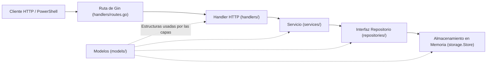
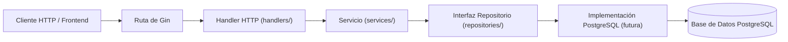

# SHOWTECH SOLUTIONS - API Gestor de Eventos (Backend Go en Desarrollo)

Este repositorio contiene el backend en desarrollo para el **Gestor de Eventos de SHOWTECH SOLUTIONS**, construido en **Go** con el framework HTTP **Gin**.

Actualmente el proyecto opera con almacenamiento en memoria protegido por exclusión mutua (`sync.RWMutex`) y estructura sus responsabilidades en capas (`handlers`, `services`, `repositories` y `storage`) para preparar la futura integración con **PostgreSQL**.

---

## 1. Estructura del Proyecto y Función de Cada Paquete

```text
gestor-eventos-api/
│
├── go.mod                        # Definición del módulo y dependencias
├── go.sum                        # Sumas de verificación de dependencias
├── main.go                       # Punto de entrada: ensambla almacenamiento, servicios y enrutador HTTP
│
├── models/
│   ├── evento.go                 # Estructura de datos Evento
│   └── solicitud.go              # Estructuras Solicitud, SolicitudCreacionDTO y DatosHorario
│
├── repositories/
│   └── repositories.go           # Interfaces EventoRepository y SolicitudRepository + errores de dominio/datos
│
├── storage/
│   └── memory.go                 # Implementación en memoria de los repositorios (protegida con sync.RWMutex)
│
├── services/
│   ├── errors.go                 # Errores de validación e identificación de fallos de negocio
│   ├── evento_service.go         # Lógica de negocio para consulta de eventos
│   ├── solicitud_service.go      # Validaciones, construcción de snapshots y coordinación de solicitudes
│   └── services_test.go          # Pruebas unitarias de servicios (sin servidor HTTP)
│
├── handlers/
│   ├── routes.go                 # Configuración de rutas de Gin, CORS y proxies confiables
│   ├── health.go                 # Handler para GET /health
│   ├── eventos.go                # Handlers HTTP para GET /eventos y GET /eventos/:id
│   ├── solicitudes.go            # Handlers HTTP para POST /solicitudes y GET /solicitudes
│   └── handlers_test.go          # Pruebas de integración HTTP sobre los endpoints
│
├── frontend/                     # Aplicación web Angular (standalone + SCSS)
│   ├── proxy.conf.json           # Proxy de desarrollo (/api -> http://127.0.0.1:8081)
│   ├── package.json              # Scripts y dependencias de Angular
│   └── src/app/
│       ├── models/               # Interfaces TypeScript alineadas con el JSON del backend
│       ├── services/             # Servicio HTTP tipado (EventosApiService) y pruebas
│       ├── validators/           # Validadores de formulario reactivo (HH:mm, rango, Unicode)
│       └── components/           # Componentes de listado de eventos, formulario y solicitudes
│
└── README.md                     # Documentación técnica del proyecto
```

### Función de cada paquete
- **`models`**: Define las estructuras de datos compartidas entre capas (`Evento`, `Solicitud`, `SolicitudCreacionDTO`, `DatosHorario`). Son estructuras utilizadas transversalmente por las capas y no un paso secuencial dentro de la petición.
- **`repositories`**: Define contratos pequeños (`EventoRepository`, `SolicitudRepository`) con soporte para `context.Context` y errores identificables (`ErrEventoNoEncontrado`, `ErrSolicitudPendienteDuplicada`).
- **`storage`**: Implementa en memoria las interfaces de `repositories` usando `sync.RWMutex`, conservando los datos iniciales de prueba y garantizando de forma atómica que no se registren dos solicitudes pendientes para el mismo evento.
- **`services`**: Contiene las reglas de negocio y validaciones (formato estricto de horas `HH:MM`, rango horario `06:00`–`22:00`, longitud Unicode del motivo, existencia de cambios reales y creación de snapshots). No importa Gin ni conoce códigos de estado HTTP.
- **`handlers`**: Recibe las peticiones HTTP de Gin, lee parámetros y cuerpos JSON, invoca a los servicios y traduce los resultados o errores a códigos HTTP (`200`, `201`, `400`, `404`, `409`, `500`). No importa `storage`.

---

## 2. Diferencia entre Handler, Servicio y Repositorio

| Capa | Responsabilidad Principal | Qué conoce | Qué NO debe hacer |
| :--- | :--- | :--- | :--- |
| **Handler (`handlers/`)** | Transporte HTTP: leer parámetros de ruta y JSON, invocar al servicio y devolver respuestas JSON con el código HTTP adecuado. | `gin.Context`, códigos HTTP (`400`, `404`, `409`, `500`), DTOs y errores del servicio. | Validar reglas de negocio complejas, construir snapshots o acceder directamente a `storage`. |
| **Servicio (`services/`)** | Reglas de negocio: validar datos de entrada, comprobar existencia del evento, construir los snapshots (`datos_originales` y `datos_propuestos`) y coordinar el guardado. | Modelos de dominio, interfaces de `repositories`, reloj inyectable (`ClockFunc`). | Importar `gin`, devolver códigos HTTP o ejecutar consultas directas a estructuras de almacenamiento. |
| **Repositorio (`repositories/` + `storage/`)** | Acceso y resguardo de datos: consultar y almacenar entidades cumpliendo invariantes de consistencia (como la unicidad atómica de solicitud pendiente por evento). | `context.Context`, estructuras de `models` y primitivas de sincronización o persistencia. | Decidir códigos de respuesta HTTP o formatear mensajes de validación de interfaz. |

---

## 3. Diagramas de Arquitectura

### A. Arquitectura Implementada Actualmente (Almacenamiento en Memoria)



### B. Futura Conexión con PostgreSQL

Cuando el equipo defina el mecanismo de acceso a datos en PostgreSQL (la elección entre ORM y SQL directo continúa pendiente de acuerdo con el equipo), se agregará una implementación concreta de las interfaces de `repositories/` sin alterar el contrato HTTP de los handlers:



---

## 4. Ejemplo del Recorrido de `POST /solicitudes`

1. **Petición HTTP**: El cliente envía `POST /solicitudes` con el JSON de `SolicitudCreacionDTO`.
2. **Ruta de Gin (`handlers/routes.go`)**: Dirige la petición a `CrearSolicitudHandler(solicitudService)`.
3. **Handler (`handlers/solicitudes.go`)**:
   - Deserializa el cuerpo JSON mediante `c.ShouldBindJSON(&dto)`. Si faltan campos requeridos o el JSON es inválido, responde `400 Bad Request`.
   - Llama a `solicitudService.CrearSolicitud(c.Request.Context(), dto)`.
4. **Servicio (`services/solicitud_service.go`)**:
   - Consulta `eventoRepo.ObtenerEventoPorID(ctx, dto.EventoID)`. Si no existe, retorna `ErrEventoNoEncontrado`.
   - Limpia espacios externos del motivo y verifica que no sea vacío ni supere 400 caracteres Unicode (`utf8.RuneCountInString`).
   - Valida que `fecha_propuesta` cumpla el formato `YYYY-MM-DD`.
   - Valida que `hora_inicio_propuesta` y `hora_fin_propuesta` tengan formato estricto `HH:MM` (dos dígitos, dos puntos y dos dígitos), estén entre `06:00` y `22:00` inclusive y que la hora de inicio sea anterior a la de fin.
   - Verifica que exista al menos un cambio en fecha u horario frente al evento original.
   - Construye la entidad `models.Solicitud` con estado `"Pendiente de revisión"`, `fecha_creacion` generada a partir del reloj inyectado en estándar RFC 3339 con offset de zona horaria explícito (`time.RFC3339`, p. ej. `2026-11-06T15:05:32-05:00` o `2026-11-06T20:05:32Z`) y los snapshots `datos_originales` y `datos_propuestos`.
   - Invoca a `solicitudRepo.CrearSolicitud(ctx, nuevaSolicitud)`.
5. **Repositorio / Almacenamiento (`storage/memory.go`)**:
   - Adquiere el bloqueo de escritura (`s.mu.Lock()`).
   - Verifica de manera atómica que el evento exista y que no tenga otra solicitud en estado `"Pendiente de revisión"`. Si ya existe una, devuelve `ErrSolicitudPendienteDuplicada`.
   - Asigna el `ID` secuencial, guarda la solicitud en memoria y la retorna.
6. **Respuesta HTTP (`handlers/solicitudes.go`)**:
   - Si el servicio retorna un error, el handler lo clasifica con `errors.Is`:
     - `ErrDatosInvalidos` → `400 Bad Request`
     - `ErrEventoNoEncontrado` → `404 Not Found`
     - `ErrSolicitudPendienteDuplicada` → `409 Conflict`
     - Cualquier otro error inesperado → `500 Internal Server Error` (sin exponer detalles internos).
   - Si tiene éxito, responde `201 Created` con `{"mensaje": "...", "solicitud": {...}}`.

---

## 5. Configuración Local, Ejecución y Pruebas

El servidor escucha en `127.0.0.1:8081`:

- **Health Check**: `http://127.0.0.1:8081/health`
- **Listar Eventos**: `http://127.0.0.1:8081/eventos`
- **Detalle de Evento**: `http://127.0.0.1:8081/eventos/1`
- **Solicitudes**: `http://127.0.0.1:8081/solicitudes`

### A. Iniciar el servidor

```powershell
# Si Go está disponible en PATH:
go run main.go

# Usando la ruta absoluta de Go en Windows:
& "C:\Program Files\Go\bin\go.exe" run main.go
```

Para detener el servidor, presiona `Ctrl + C` en la terminal.

### B. Ejecutar verificaciones y pruebas automatizadas del backend

```powershell
& "C:\Program Files\Go\bin\go.exe" vet ./...
& "C:\Program Files\Go\bin\go.exe" test -count=1 ./...
```

### C. Iniciar y verificar el frontend Angular (`http://localhost:4200`)

El frontend implementa el recorrido del portal en **cuatro pasos** conectado a la API real (`GET /api/eventos`, `GET /api/solicitudes` y `POST /api/solicitudes`), mostrando una sección principal visible por vez:

1. **Paso 1 — Eventos**: Tarjetas horizontales con el identificador numérico real de cada evento, espacio, fecha y horario confirmado, botón `"Solicitar modificación"`, bloqueo automático cuando ya existe una solicitud en estado `"Pendiente de revisión"` y listado inferior de `"Solicitudes de modificación"` (tabla en escritorio y tarjetas en móvil) con acceso al modal accesible de detalle.
2. **Paso 2 — Proponer cambios**: Resumen en solo lectura del evento seleccionado (ID, nombre y espacio), edición de `Fecha propuesta`, `Hora de inicio propuesta`, `Hora de fin propuesta` y `Motivo de la solicitud` con validaciones reactivas (`YYYY-MM-DD`, `HH:mm` entre `06:00` y `22:00`, inicio anterior al fin, máximo 400 caracteres Unicode y al menos un cambio respecto al original), insignia `"Modificado"` por campo y modal de confirmación antes de descartar un borrador editado.
3. **Paso 3 — Revisar solicitud**: Tabla comparativa entre los valores actuales confirmados y los valores propuestos, visualización del motivo y envío mediante `POST /api/solicitudes` con bloqueo de doble envío y conservación del borrador en caso de fallo o conflicto `409`.
4. **Paso 4 — Solicitud enviada**: Pantalla accesible tras recibir `201 Created`, mostrando los datos reales devueltos por el servidor en estado `"Pendiente de revisión"`, acceso al detalle completo y retorno al listado de eventos.

En otra terminal PowerShell dentro de la subcarpeta `frontend/` (con el backend Go ejecutándose en `127.0.0.1:8081`):

```powershell
cd frontend

# Iniciar servidor de desarrollo en http://localhost:4200 con proxy /api -> http://127.0.0.1:8081
npm start

# Compilar para producción
npm run build

# Ejecutar pruebas unitarias de Angular sin modo watch
npx ng test --watch=false
```

---

## 6. Ejemplos de Uso desde PowerShell (`Invoke-RestMethod`)

### 1. Consultar estado del servicio (`GET /health`)
```powershell
Invoke-RestMethod -Uri "http://127.0.0.1:8081/health" -Method Get | ConvertTo-Json
```

### 2. Listar eventos (`GET /eventos`)
```powershell
Invoke-RestMethod -Uri "http://127.0.0.1:8081/eventos" -Method Get | ConvertTo-Json
```

### 3. Consultar detalle de un evento (`GET /eventos/:id`)
```powershell
# Evento existente (HTTP 200)
Invoke-RestMethod -Uri "http://127.0.0.1:8081/eventos/1" -Method Get | ConvertTo-Json

# Evento inexistente (HTTP 404)
try {
    Invoke-RestMethod -Uri "http://127.0.0.1:8081/eventos/99" -Method Get
} catch {
    Write-Host "Código devuelto: $($_.Exception.Response.StatusCode.value__)"
}

# ID inválido o cero (HTTP 400)
try {
    Invoke-RestMethod -Uri "http://127.0.0.1:8081/eventos/0" -Method Get
} catch {
    Write-Host "Código devuelto: $($_.Exception.Response.StatusCode.value__)"
}
```

### 4. Registrar una solicitud de modificación válida (`POST /solicitudes` -> HTTP 201)
```powershell
$solicitudValida = @{
    evento_id             = 1
    motivo                = "Ajuste de agenda por disponibilidad del conferencista principal"
    fecha_propuesta       = "2026-11-28"
    hora_inicio_propuesta = "10:00"
    hora_fin_propuesta    = "14:00"
} | ConvertTo-Json

Invoke-RestMethod -Uri "http://127.0.0.1:8081/solicitudes" -Method Post -Body $solicitudValida -ContentType "application/json" | ConvertTo-Json -Depth 5
```

### 5. Consultar solicitudes registradas (`GET /solicitudes`)
```powershell
Invoke-RestMethod -Uri "http://127.0.0.1:8081/solicitudes" -Method Get | ConvertTo-Json -Depth 5
```

### 6. Intentar registrar una segunda solicitud pendiente para el mismo evento (HTTP 409)
```powershell
try {
    $solicitudDuplicada = @{
        evento_id             = 1
        motivo                = "Intento de registrar segunda solicitud pendiente"
        fecha_propuesta       = "2026-11-29"
        hora_inicio_propuesta = "11:00"
        hora_fin_propuesta    = "15:00"
    } | ConvertTo-Json
    Invoke-RestMethod -Uri "http://127.0.0.1:8081/solicitudes" -Method Post -Body $solicitudDuplicada -ContentType "application/json"
} catch {
    Write-Host "Conflicto esperado detectado: Código $($_.Exception.Response.StatusCode.value__)"
}
```

### 7. Intentar registrar un horario con formato u orden inválido (HTTP 400)
```powershell
try {
    $horarioInvalido = @{
        evento_id             = 2
        motivo                = "Formato de hora incompleto o rango inválido"
        fecha_propuesta       = "2026-11-25"
        hora_inicio_propuesta = "9:00"
        hora_fin_propuesta    = "12:00"
    } | ConvertTo-Json
    Invoke-RestMethod -Uri "http://127.0.0.1:8081/solicitudes" -Method Post -Body $horarioInvalido -ContentType "application/json"
} catch {
    Write-Host "Error de validación esperado: Código $($_.Exception.Response.StatusCode.value__)"
}
```

---

## 7. Alcance, Compatibilidad y Trabajo Pendiente

- **Compatibilidad de snapshots y registros**:
  - Las estructuras de snapshots `datos_originales` y `datos_propuestos` contienen la información general del evento (`nombre`, `espacio`, `contacto`, `telefono`, `correo`, `observaciones`) junto con fecha y horario.
  - Para solicitudes históricas o creadas sin datos de contacto, la interfaz presenta `"Dato no disponible en este registro"`.
  - Para campos opcionales (`telefono`, `correo`, `observaciones`) que hayan sido explícitamente vaciados o no provistos en registros vigentes, la interfaz presenta `"Sin especificar"`.
- **Persistencia en memoria volátil**: Los datos se reinician al detener el proceso. La integración con PostgreSQL y la definición entre ORM o SQL directo se abordarán en una siguiente etapa.
- **Formato y manejo de `fecha_creacion`**: Las nuevas solicitudes se generan en estándar RFC 3339 con offset de zona horaria explícito (`time.RFC3339`, como `2026-11-06T15:05:32-05:00`). El frontend convierte de forma consistente estos instantes a la zona horaria `America/Lima` (`DD/MM/YYYY, HH:mm:ss`), manteniendo a la vez compatibilidad retroactiva completa con registros legacy que contengan formato `"YYYY-MM-DD HH:MM:SS"`.
- **Operaciones de ciclo de vida, propiedad y seguridad**: Aún no están implementados la autenticación, el filtrado por propietario de eventos/solicitudes (por lo que la interfaz presenta el catálogo general de `"Eventos"` y `"Solicitudes de modificación"` sin simular cuentas de usuario) ni los flujos de retiro, aprobación o rechazo de solicitudes.
